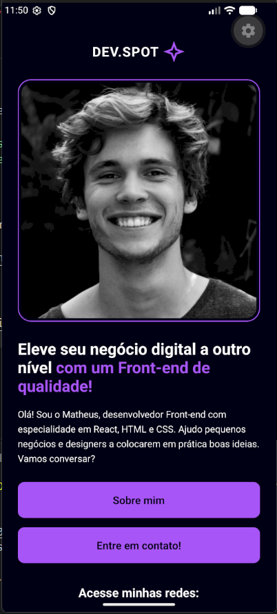
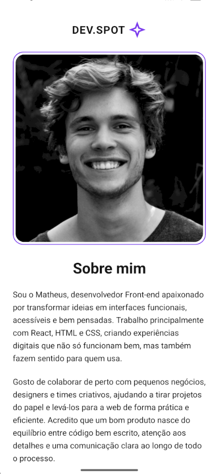

# Dev.Spot

Aplicativo mobile de apresentação profissional (portfólio), desenvolvido com **React Native**, **Expo** e **TypeScript**. O app reproduz duas telas: uma **Home**, com a apresentação do desenvolvedor, e uma tela **Sobre mim**, com a biografia.

> Projeto fictício, sem fins comerciais, desenvolvido para a Atividade Bimestral 1.

## Integrantes

- Matheus Duarte
- Vinicius Ernani bessa dos Santos

## Descrição

O Dev.Spot apresenta o perfil de Matheus, desenvolvedor Front-end especializado em React, HTML e CSS. O usuário pode conhecer mais sobre ele, entrar em contato e acessar suas redes sociais.

## Funcionalidades

### Tela Home
- Logo no topo, imagem de perfil, título e texto de apresentação
- Botão **"Sobre mim"**: navega para a segunda tela
- Botão **"Entre em contato!"**: exibe um Alert com a mensagem "Entre em contato"
- Seção **"Acesse minhas redes"** com botões para GitHub, LinkedIn, Instagram e Twitch
- **Switch "Alterar visualização"**: alterna entre modo escuro e modo claro

### Tela Sobre mim
- Título "Sobre mim" e texto descritivo em parágrafos
- Rodapé com os créditos
- Botão **"Voltar"** para retornar à Home

### Diferenciais
- **Dark mode / alternância de tema**: modo escuro (roxo e preto) e modo claro, controlado por um Context e aplicado nas duas telas
- **Animações simples**: os botões encolhem levemente ao toque e crescem de leve ao passar o mouse
- **Ícones personalizados**: ícones das redes sociais e do logo com `@expo/vector-icons`
- **Links reais**: os botões das redes sociais abrem os perfis no navegador ou no app correspondente
- **Responsividade**: layout com larguras relativas e `ScrollView`, adaptável a diferentes tamanhos de tela

## Tecnologias

- React Native + Expo
- TypeScript
- React Navigation (native stack)
- @expo/vector-icons

## Como executar

1. Clone o repositório:
```
   git clone https://github.com/viniciusEB/atividade-bimestral1.git
   cd atividade-bimestral1
```
2. Instale as dependências:
```
   npm install
```
3. Inicie o projeto:
```
   npm run start
```
4. Escaneie o QR Code com o **Expo Go** ou abra no emulador Android (tecla `a` no terminal).

> O Expo Go precisa ser compatível com a versão do SDK do projeto (veja `expo` no `package.json`). Se aparecer erro de incompatibilidade, baixe o Expo Go correspondente em [expo.dev/go](https://expo.dev/go).

## Prints

| Home (escuro) | Home (claro) |
| :-: | :-: |
|  |  |

| Sobre mim (escuro) | Sobre mim (claro) |
| :-: | :-: |
|  |  |

## Estrutura

```
App.tsx                      ponto de entrada e navegação entre telas

prints
src/
├── theme.ts                 paletas de cores (escuro e claro)
├── ThemeContext.tsx         contexto que controla o tema
├── hooks/
│   └── useScaleAnimation.ts animação de escala dos botões
├── types/
│   └── navigation.ts        tipos das rotas
├── components/              componentes reutilizáveis, um por pasta
│   ├── ActionButton/
│   ├── SocialButton/
│   ├── Logo/
│   └── Footer/
└── screens/
    ├── Home/
    └── Sobre/
```

Cada componente e cada tela seguem o padrão `Nome.tsx` (estrutura) + `NomeStyles.tsx` (estilos).